  
  
  
  
  
  
  

# 🚀 Awesome LLM Web Interfaces & AI Workspaces

**A curated index of top-tier open-source GitHub repositories and SaaS platforms for Large Language Model (LLM) Web UIs, chat clients, local model runners, and multi-provider agentic workspaces.**

*Compare, self-host, and deploy ChatGPT-like frontends with local offline inference, multi-model side-by-side comparison, RAG document search, and enterprise-grade authentication.*

📅 **Last updated: October 2026** • 🌟 Maintained by [@ishandutta2007](https://github.com/ishandutta2007)

---

## 📑 Table of Contents

- [🌐 Sector Overview & Market Dynamics](#-sector-overview--market-dynamics)
- [🏢 SaaS & Hosted Platforms](#-saas--hosted-platforms)
- [💻 Open-Source GitHub Projects](#-open-source-github-projects)
- [🤝 How to Contribute](#-how-to-contribute)
- [💖 Support & Sponsorship](#-support--sponsorship)
- [⚖️ Disclaimer & Privacy Notes](#-disclaimer--privacy-notes)
- [📈 Star History](#-star-history)

---

## 🌐 Sector Overview & Market Dynamics

The LLM web interface and developer application sector is part of the rapidly growing Generative AI application layer, estimated at **$25B–$55B+ globally by 2026** (growing at a 30%–40% CAGR). While the foundational model layer remains concentrated among hyperscalers and frontier labs (OpenAI, Anthropic, Google, Meta), the front-end interface and tooling space is **moderately to highly fragmented**, characterized by open-source innovation, indie bootstrappers, and specialized multi-model client platforms competing for developer and workspace mindshare.

---

## 🏢 SaaS & Hosted Platforms

| Platform | Starting Tier Price | Free Tier / Trial Limits | Company Size (Valuation / Revenue) | Description |
| :--- | :--- | :--- | :--- | :--- |
| **[Poe (by Quora)](https://poe.com/)** | $10.00/month (Lite monthly) | 300 compute points per day (resets every 24 hours, non-rollover; access to basic models) | ~$500M valuation ($75M Series D from a16z; ~$65M ARR) | Freemium multi-bot ecosystem and consumer hub for accessing models from OpenAI, Anthropic, Google, and independent creators under unified point quotas. |
| **[LM Studio](https://lm-studio.cn/)** | $20.00/month (Bionic+ tier for hosted frontier open models) | Unlimited local usage forever (zero fees for local models; Bionic free includes local execution, offline voice transcription, and LM Link for up to 5 devices; hosted cloud frontier models require paid plan) | $19.3M venture funding (~$1.8M ARR; Element Labs) | Polished desktop client and local runtime for running GGUF/MLX models offline with OpenAI-compatible endpoints, MCP client support, and optional cloud model add-ons. |
| **[TypingMind](https://www.typingmind.com/)** | $39.00 one-time (Standard license) / $99.00/month (Team 5-seat tier) | Unlimited BYOK chats forever (chat history is not saved locally across browser sessions; periodic upgrade prompts; advanced features like AI agents and web search restricted) | ~$1.5M+ ARR (Bootstrapped by Tony Dinh; no external VC funding) | Feature-packed commercial web frontend for LLM APIs (OpenAI, Claude, Gemini) with prompt libraries, custom agents, and team workspaces. |
| **[Big-AGI Pro](https://big-agi.com/)** | $9.00/month ($108.00/year annual tier) | Unlimited local-first BYOK chats forever (full access to Beam multi-model testing and personas; no cloud backups or cross-device cloud sync included on free tier) | Bootstrapped / Community sponsored ($0 institutional funding; supported via Pro subs & GitHub Sponsors) | Local-first, power-user interface featuring 'Beam' multi-model parallel prompt exploration, custom persona workspaces, and optional cloud synchronization. |
| **[ChatHub](https://chathub.gg/)** | $14.99/month ($179.88/year billed annually; $19.00/month billed monthly) | Up to 3 AI chats and 3 file uploads on web client forever (unlimited messages if using browser extension with personal provider logins / BYOK accounts) | Bootstrapped / Indie (~$0 institutional VC funding) | Multi-model chatbot aggregator extension and web client letting users run side-by-side prompt comparisons across ChatGPT, Claude, Gemini, and Grok. |

---

## 💻 Open-Source GitHub Projects

*Ranked in descending order of popularity based on real-time GitHub stargazer counts.*

### 1. [Ollama](https://github.com/ollama/ollama) 
> **The open-source local model runner standard** • MIT License

One-command model pull and run (`ollama run gemma4` or `ollama run llama3`). 
- **Key Differentiator**: Native integrations via `ollama launch` for OpenCode, Claude Code, Codex, VS Code, and Droid—wiring local models to coding agents with zero friction.
- **CLI & Core Capabilities**: Chat, model management, embedding generation, vision/speech pipelines, and Modelfile customization.
- **API**: Built-in OpenAI-compatible server at `http://localhost:11434`.
- **Best For**: Developers seeking the easiest, fastest local model execution with seamless agent and CLI integration.

---

### 2. [Open WebUI](https://github.com/open-webui/open-webui) 
> **The full-featured self-hosted agentic platform and ChatGPT alternative** • Open Source

Positioned as the comprehensive platform layer on top of local runtimes like Ollama and remote APIs.
- **Key Differentiator**: Autonomous model tool-calling, Model Context Protocol (MCP) servers, sub-agents, automations, and sandboxed code execution (Open Terminal).
- **Knowledge & RAG**: Integrates with 13 vector databases and 8 document extraction engines out of the box.
- **Enterprise Ready**: Role-based access control (RBAC), multi-user Channels, SSO/OIDC/LDAP, and SCIM 2.0.
- **Best For**: Teams and power users demanding an air-gapped, collaborative ChatGPT-grade interface.

---

### 3. [NextChat (ChatGPT-Next-Web)](https://github.com/ChatGPTNextWeb/NextChat) 
> **Lightweight, one-click deployable cross-platform AI workspace** • MIT License

An ultra-fast, cross-platform chat client (Web, PWA, Desktop on macOS/Windows/Linux) designed for multi-provider BYOK access.
- **Key Differentiator**: Instant zero-config 1-click deployment on Vercel or Docker in under 1 minute with compressed client bundles.
- **Capabilities**: Custom prompt masks/templates, artifact previewing, real-time web search, and support for OpenAI, Claude, Gemini, and Ollama.
- **Best For**: Users wanting a responsive, turnkey chat application deployable anywhere with zero server overhead.

---

### 4. [LobeChat](https://github.com/lobehub/lobe-chat) 
> **Modern multi-modal agent workspace with plugin ecosystem** • Apache 2.0 License

An exquisitely designed open-source AI conversational platform with full multi-modal and agent ecosystem support.
- **Key Differentiator**: Rich plugin marketplace with real-time web browsing, Python code execution, visual image generators, and function-calling.
- **Capabilities**: Text-to-Speech (TTS), speech recognition (STT), custom agent assistants, multi-modal vision models, and local Ollama synchronization.
- **Best For**: Power users and creators desiring an Apple-grade UI experience with extensive third-party plugins.

---

### 5. [GPT4All](https://github.com/nomic-ai/gpt4all) 
> **Privacy-first desktop assistant with on-device LocalDocs** • MIT License

Desktop GUI created by Nomic AI designed to run entirely offline on consumer laptops and desktop hardware without an internet connection.
- **Key Differentiator**: **LocalDocs**—allows private semantic search and Q&A over local folders and documents using embedded local vector databases (Nomic Embed).
- **Capabilities**: Cross-platform desktop client (Windows, macOS, Linux), catalog of verified quantized models, and built-in local server mode.
- **Best For**: Privacy-conscious individuals and non-technical users requiring local document Q&A without cloud leakage.

---

### 6. [AnythingLLM](https://github.com/Mintplex-Labs/anything-llm) 
> **The all-in-one private AI workspace with built-in RAG and multi-user support** • MIT License

An end-to-end AI application and enterprise-ready workspace designed to query documents, media, and codebases locally or in private clouds.
- **Key Differentiator**: Built-in full-text document parser (PDF, Word, YouTube transcripts, audio) with native vector database embedding and zero setup needed.
- **Capabilities**: Multi-user permissions, workspace segregation, multi-model routing (Ollama, LM Studio, OpenAI, Anthropic), and agent skills.
- **Best For**: Businesses, research groups, and developers needing a turnkey, complete document RAG stack.

---

### 7. [LocalAI](https://github.com/mudler/LocalAI) 
> **The self-hosted drop-in OpenAI-compatible multi-modal AI stack** • MIT License

A versatile, self-hosted C++ engine providing a complete drop-in replacement for OpenAI APIs across text, image, audio, and embeddings.
- **Key Differentiator**: Full multi-modal processing—supports text generation (llama.cpp, vLLM), image synthesis (Stable Diffusion), transcription (Whisper), and TTS in a unified server.
- **Capabilities**: Hardware auto-detection (NVIDIA, AMD ROCm, Intel Arc, Apple Silicon), LocalAGI autonomous agent framework, and LocalRecall search.
- **Best For**: Infrastructure engineers requiring an all-in-one local alternative to commercial AI API clouds.

---

### 8. [Text Generation WebUI (TextGen)](https://github.com/oobabooga/text-generation-webui) 
> **The power-user's versatile playground for model backends** • AGPL-3.0 License

A Gradio-based web interface and inference server revered among AI researchers and power users.
- **Key Differentiator**: Multi-backend engine—switch dynamically between `llama.cpp`, Transformers, ExLlamaV2/V3, AutoGPTQ, AutoAWQ, and Hqq loaders.
- **Capabilities**: Notebook, chat, and raw generation modes; OpenAI-compatible API; extension architecture for TTS, whisper, translation, and character lorebooks.
- **Best For**: AI practitioners who benchmark and experiment across different quantization standards and GPU hardware.

---

### 9. [LibreChat](https://github.com/danny-avila/LibreChat) 
> **Unified multi-provider enterprise AI chat platform** • MIT License

An open-source interface unifying OpenAI, Anthropic Claude, Google Gemini, AWS Bedrock, Azure, Mistral, and local runtimes under one pane of glass.
- **Key Differentiator**: Model Context Protocol (MCP) integration, customizable system presets, multilingual UI (30+ languages), and ClickHouse Agentic Data Stack integration.
- **Capabilities**: Robust authentication (OAuth, SAML, LDAP, 2FA), moderation pipelines, token rate-limiting, and code artifact execution.
- **Best For**: Organizations needing a centralized, vendor-neutral enterprise chat gateway with role management.

---

### 10. [Jan](https://github.com/janhq/jan) 
> **The 100% open-source, privacy-first desktop alternative to LM Studio** • AGPL-3.0 License

An elegant native desktop client (macOS, Windows, Linux) that allows downloading, running, and fine-tuning open-source LLMs offline.
- **Key Differentiator**: Dual desktop and CLI workflows (`jan serve` and `jan launch`) to seamlessly bind local models into developer coding agents (Claude Code, OpenClaw).
- **Capabilities**: LlamaCPP and Apple MLX acceleration, local REST API at `localhost:6767`, zero cloud telemetry, and zero subscription fees.
- **Best For**: Developers wanting a clean desktop GUI backed by verifiable open-source code and zero telemetry.

---

### 11. [SillyTavern](https://github.com/SillyTavern/SillyTavern) 
> **Advanced narrative frontend and roleplay character chat studio** • LLPL / Open Source

A specialized, feature-dense user interface tailored for interactive storytelling, roleplay, and conversational characters.
- **Key Differentiator**: Sophisticated context management—lorebooks (World Info), author's notes, custom token samplers, group chats, and expression avatars.
- **Capabilities**: Compatible with local backends (Ollama, TextGen, KoboldAI) and cloud APIs (OpenAI, Claude, NovelAI), with integrated local TTS and voice generation.
- **Best For**: Creative writers, game designers, and enthusiasts focusing on persona-based interactive roleplay.

---

### 12. [Chatbot UI](https://github.com/mckaywrigley/chatbot-ui) 
> **Clean open-source ChatGPT clone built with Next.js & Supabase** • MIT License

An intuitive, responsive frontend replicating the familiar ChatGPT UI for developers who want a lightweight BYOK platform.
- **Key Differentiator**: Simple Next.js code architecture that is straightforward to clone, white-label, or modify.
- **Capabilities**: BYOK support for OpenAI, Anthropic, Mistral, Groq, local Ollama endpoints, prompt templates, and chat folder organization.
- **Best For**: Developers building custom AI prototypes or seeking an unfettered personal chat UI.

---

### 13. [big-AGI](https://github.com/enricoros/big-AGI) 
> **Local-first generative workspace featuring multi-model Beam comparison** • MIT License

A high-performance web application designed for prompt engineers, researchers, and AI experimenters.
- **Key Differentiator**: **Beam mode**—dispatch prompts simultaneously across multiple competing models (e.g., GPT-4o, Claude 3.5 Sonnet, Gemini 1.5 Pro, and Llama 3) to analyze, compare, and merge responses.
- **Capabilities**: Local-first storage, custom personas, deep token inspector, voice input, and multi-model synthesis.
- **Best For**: Power users and researchers evaluating prompt variance across multiple foundation models.

---

## 🤝 How to Contribute

Contributions are warmly welcomed! Help keep this curated list up-to-date:

1. 🍴 **Fork the repository** to your GitHub account.
2. 🌿 **Create a new branch** (`git checkout -b feature/add-new-interface`).
3. 📝 **Add or update entries** in `README.md` keeping descriptions factual, concise, and linked to official repositories or sites.
4. 🌟 Follow existing formatting conventions (include license, key features, and stargazers badge).
5. 🚀 **Submit a Pull Request** with a brief summary of the project and why it belongs in the ecosystem.

---

## 💖 Support & Sponsorship

If you find **Awesome LLM Web Interfaces** valuable for your local inference setups, research, or team deployments:

- ⭐ **Star this repository** to help others discover it!
- 🍴 **Fork & Share** it with colleagues, developers, and AI communities.
- ☕ **Support future development & maintenance**: You can sponsor this project or buy a coffee via the official Sponsor Dashboard:
  
  

Thank you to all contributors, maintainers, and community members pushing open-source AI interfaces forward!

---

## ⚖️ Disclaimer & Privacy Notes

- 🔍 **Community Curated**: This is an open ecosystem directory—inclusion does not constitute an endorsement.
- 🔓 **Open-Source Transparency**: Open-source licenses vary (MIT, Apache 2.0, AGPL-3.0). Tools like LM Studio provide free desktop binaries but remain closed-source; verify licensing for enterprise commercial deployment.
- 🛡️ **Privacy & Local Execution**: Running models locally on your hardware ensures prompt weights stay on-device; however, external telemetry, web search extensions, and remote MCP servers communicate over the network. Always inspect outbound connections in sensitive environments.
- ⚡ **Hardware Acceleration**: Inference speed depends heavily on your hardware and quantization format (`ExLlamaV2/V3` for NVIDIA GPUs, `MLX` for Apple Silicon, `llama.cpp GGUF` for universal CPU/GPU). Benchmark your target machine before deploying at scale.

---

## 📈 Star History

